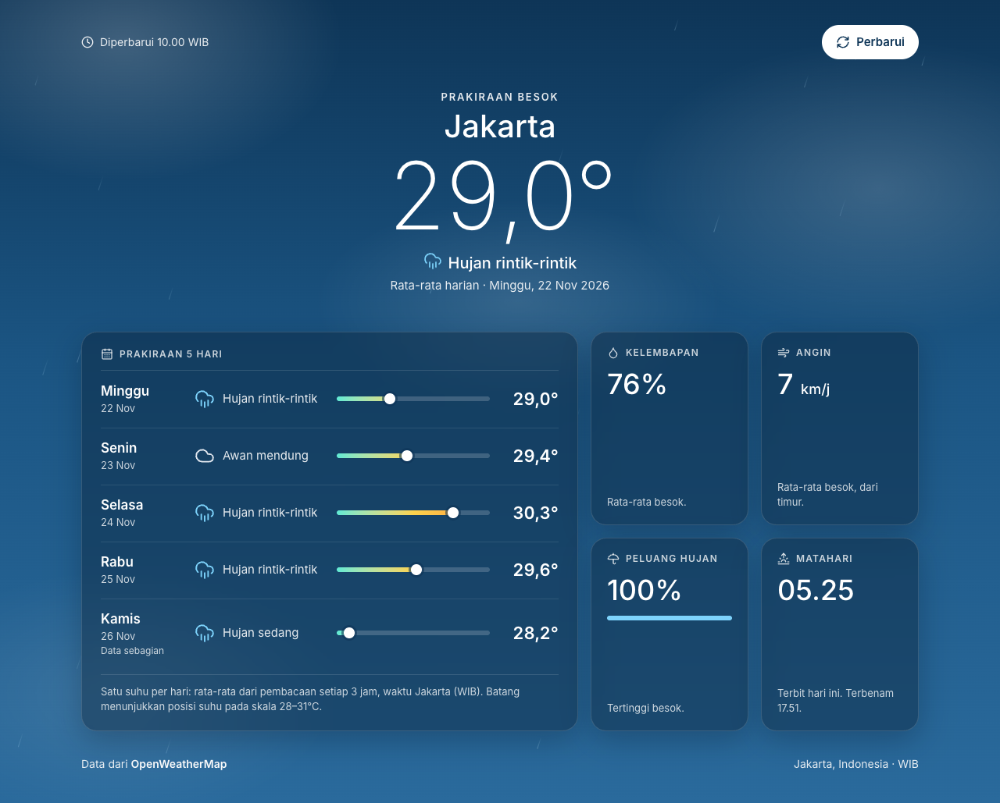
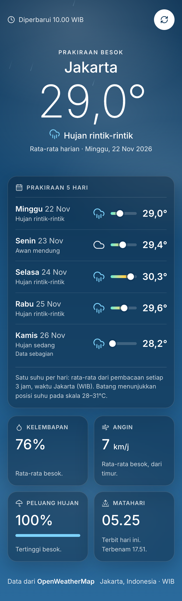

# 2-react: Cuaca Jakarta

A web version of task 2: the Jakarta weather forecast for the next 5 days from OpenWeatherMap, with **one temperature per day**. Like the CLI in [`../2/`](../2/index.js), each day's temperature is the average of all 3-hourly readings on that date (Jakarta time), starting tomorrow, so the numbers match the CLI output. The interface text is in Indonesian.

React 19, Vite, TypeScript, Tailwind CSS v4 and Motion. Requires Node 20.19 or newer and Yarn 1.

| Desktop                                         | Mobile                                                                  |
| ----------------------------------------------- | ----------------------------------------------------------------------- |
|  |  |

Screenshots taken on 21 Nov 2026 with live data.

## Running it

The API key is not in the source code. Copy the example file and fill in your key (a free key is available at https://home.openweathermap.org/api_keys):

```bash
cp .env.example .env
```

If you already filled in `../2/.env` for the CLI, the variable name is the same (`OPENWEATHER_API_KEY`), so you can copy that file instead:

```bash
cp ../2/.env .env
```

Then install and start the dev server:

```bash
yarn install
yarn dev
```

Open http://localhost:5173. Without a key, the page shows the setup steps instead of the forecast.

## How the API key stays private

The browser never sees the key. The page calls `GET /api/weather/forecast` on its own origin. That endpoint is a small Vite plugin, [`server/weather-api.ts`](server/weather-api.ts), which adds `appid` from `.env` and forwards the request to OpenWeatherMap. The city is fixed to `Jakarta,ID`, so the endpoint is not an open proxy. The variable deliberately has no `VITE_` prefix, which keeps Vite from putting it in the browser bundle.

The endpoint runs under `yarn dev` and `yarn preview`. Static hosting (Netlify, for example) would need a serverless function with the same logic before the page could work online.

## Scripts

| Command        | What it does                                                |
| -------------- | ----------------------------------------------------------- |
| `yarn dev`     | Dev server on port 5173                                     |
| `yarn build`   | Type-check and production build to `dist/`                  |
| `yarn preview` | Serve the production build (the API endpoint runs here too) |
| `yarn test`    | Unit and component tests (Vitest)                           |
| `yarn lint`    | ESLint                                                      |
| `yarn format`  | Prettier                                                    |

## What the page shows

- Tomorrow's average temperature in large type, with the weather condition.
- A 5-day list: the most frequent condition, one average temperature, and a bar that places that temperature on the 5-day range. The last day usually has only part of its readings, because the API covers about 120 hours. Such a day is labelled "Data sebagian" (partial data).
- Tomorrow's humidity, wind and chance of rain, plus today's sunrise and sunset. All of it comes from the same API response.
- Loading, error (with a retry button) and missing-API-key states, plus a banner when a refresh fails while older data is still on screen.
- Motion: slowly drifting clouds, a weather effect that matches tomorrow's condition (rain, faint lightning or sunlight), cloud parallax that follows the mouse and the scroll position, cards that lift with a soft spotlight under the cursor, day rows that highlight on hover, a count-up on the main temperature, and content that fades in while scrolling. All motion turns off when the system asks for reduced motion (`prefers-reduced-motion`).

## Tests

```bash
yarn test
```

29 tests cover:

- grouping readings by Jakarta date, skipping today, averaging per day and flagging partial days ([`src/utils/__tests__/forecast.test.ts`](src/utils/__tests__/forecast.test.ts));
- Indonesian number, date and time formatting ([`src/utils/__tests__/format.test.ts`](src/utils/__tests__/format.test.ts));
- the page in each state: loaded, missing key, error with retry, failed refresh ([`src/app/pages/HomePage/__tests__/HomePage.test.tsx`](src/app/pages/HomePage/__tests__/HomePage.test.tsx)).

## Project structure

```text
server/weather-api.ts        Vite plugin: /api/weather/forecast with the key added server-side
src/
  app/pages/HomePage/        The only page; picks which state to render
  layouts/forecast/          Page sections: hero, 5-day list, metric cards, error and setup panels
  components/                Generic UI (atomic design): Button, GlassPanel, WeatherIcon, …
  hooks/use-forecast.ts      Loading, refresh and error state for the page
  services/                  HTTP client and weatherService
  utils/forecast.ts          Pure data processing (daily averages, conditions, wind direction)
  utils/format.ts            id-ID formatting (27,8°, 07.55, Minggu, 22 Nov)
  css/index.css              Tailwind v4 theme: colour tokens, glass panels, animations
design-system/cuaca-jakarta/ Design system notes (MASTER.md plus the page override in pages/home.md)
```

## Notes

- TypeScript is pinned to 6.0. The current Vite template ships TypeScript 7.0, which typescript-eslint does not support yet.
- Redux Toolkit and React Router are included to follow the author's project conventions. This single page only uses local state.
