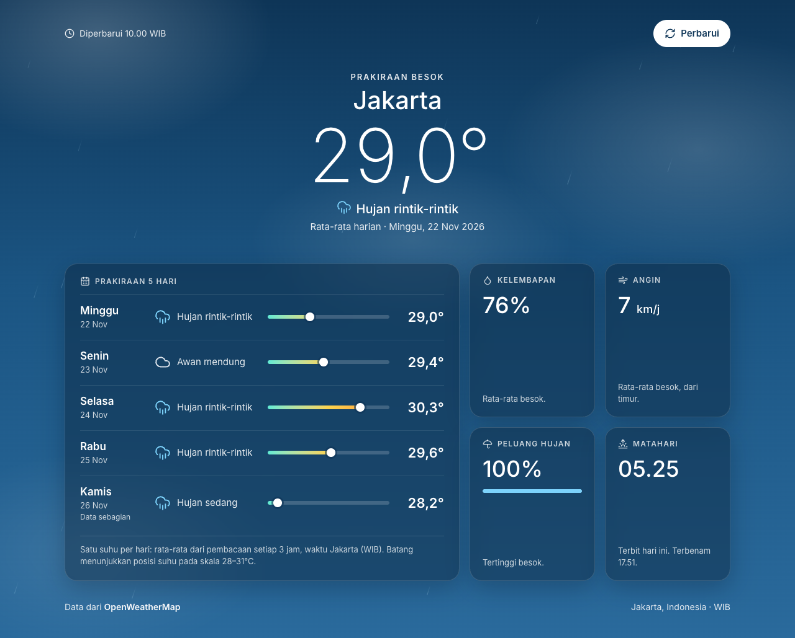

# Stamps Test

Solutions to the two Stamps interview tasks.

| Folder | What it is | Stack |
|---|---|---|
| [`1/`](1/index.js) | Task 1: reversed 1–100 with Foo/Bar/FooBar, primes skipped | Plain Node.js, no dependencies |
| [`2/`](2/index.js) | Task 2: Jakarta 5-day forecast in the terminal | Plain Node.js, no dependencies |
| [`2-react/`](2-react/README.md) | Task 2 as a web page (optional extra) | React 19 + Vite + TypeScript |

Requirements: Node 20.12 or newer for `1/` and `2/`. `2-react/` needs Node 20.19 or newer and Yarn 1.

## 1. Small program

Prints 100 down to 1 on a single line, skipping prime numbers. Multiples of 3 become `Foo`, multiples of 5 become `Bar`, and multiples of both become `FooBar`.

```bash
node 1/index.js
```

Output:

```text
Bar, Foo, 98, Foo, Bar, 94, Foo, 92, 91, FooBar, 88, Foo, 86, Bar, Foo, 82, Foo, Bar, Foo, 77, 76, FooBar, 74, Foo, Bar, Foo, 68, Foo, Bar, 64, Foo, 62, FooBar, 58, Foo, 56, Bar, Foo, 52, Foo, Bar, 49, Foo, 46, FooBar, 44, Foo, Bar, Foo, 38, Foo, Bar, 34, Foo, 32, FooBar, 28, Foo, 26, Bar, Foo, 22, Foo, Bar, Foo, 16, FooBar, 14, Foo, Bar, Foo, 8, Foo, 4, 1
```

This matches the expected output in the task description.

## 2. Jakarta weather forecast

Fetches the 5 day / 3 hour forecast from OpenWeatherMap and prints one temperature per day for the next 5 days. Since the free plan only returns 3-hourly data, the temperature shown is the average of all readings for that day (Jakarta local time).

The API key is not included. Copy the example env file and put your key in it (a free key is available at https://home.openweathermap.org/api_keys):

```bash
cp 2/.env.example 2/.env
```

Then run it from inside the folder so the `.env` file is picked up:

```bash
cd 2 && node index.js
```

Or pass the key directly:

```bash
OPENWEATHER_API_KEY=your_key node 2/index.js
```

Example output (run on 21 Nov 2026; the numbers change with the live forecast):

```text
Weather Forecast:
Sun, 22 Nov 2026: 29.05°C
Mon, 23 Nov 2026: 29.39°C
Tue, 24 Nov 2026: 30.27°C
Wed, 25 Nov 2026: 29.55°C
Thu, 26 Nov 2026: 28.24°C
```

### 2-react: the same forecast as a web page

`2-react/` shows the same data in the browser, using the same daily-average rule, so the numbers match the CLI. The API key stays on the dev server and never reaches the browser. It uses the same `OPENWEATHER_API_KEY` variable, so an existing `2/.env` can be copied over:

```bash
cd 2-react
cp ../2/.env .env
yarn install
yarn dev
```

Then open http://localhost:5173.



See [`2-react/README.md`](2-react/README.md) for the mobile layout, how the API key is handled, and how to run the tests.
